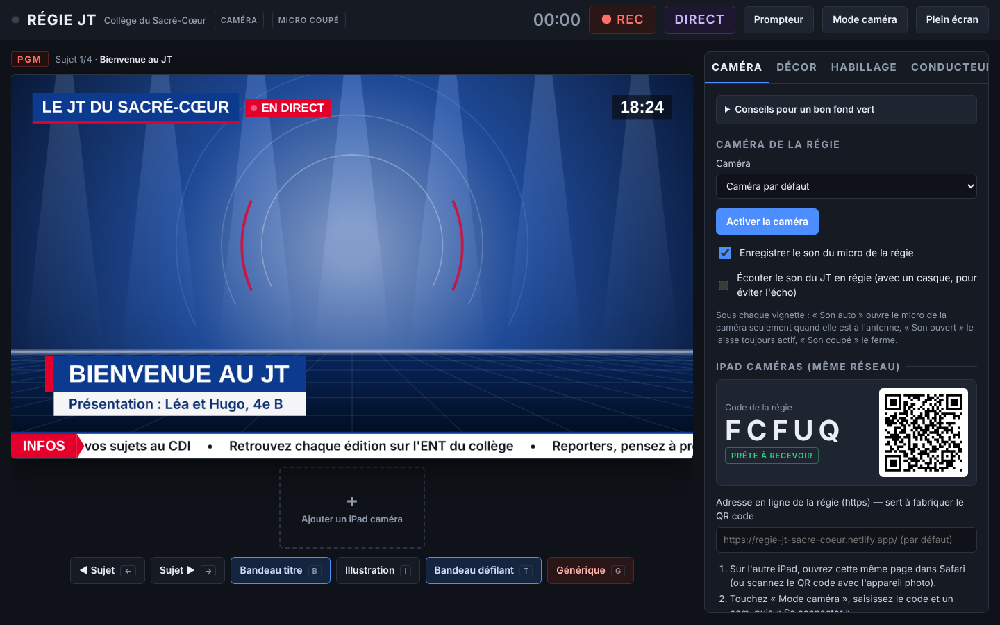

# Régie JT — le journal télévisé du collège sur fond vert

Une régie de télévision complète qui tient dans **une seule page web** : les élèves présentent le JT devant le fond vert, la régie incruste le décor, affiche les bandeaux, fait défiler le prompteur, passe d'une caméra à l'autre et enregistre l'émission. Les iPad de la classe servent de caméras supplémentaires, et un relais optionnel permet le direct sur les réseaux sociaux.

Conçue au **Collège du Sacré-Cœur de Halluin** pour le cours d'iPad de 6e. Fonctionne sur iPad (Safari) et sur ordinateur (Chrome, Edge, Safari).



**Version en ligne :** https://regie-jt-sacre-coeur.netlify.app/  
**Code source :** https://github.com/lefebvrepascal/regie-jt

---

## Fonctions

| Domaine | Ce que fait la régie |
| --- | --- |
| Fond vert | Incrustation en temps réel (WebGL), pipette, tolérance, douceur des bords, suppression des reflets verts, recadrage, vue du masque, réglages mémorisés pour chaque caméra |
| Décors | 6 plateaux dessinés (plateau TV, rédaction, ville de nuit, météo, stade, fond couleur) ou votre propre image / vidéo |
| Habillage | Logo ou nom du JT, pastille « EN DIRECT », horloge, bandeau défilant, bandeau titre du sujet, générique animé avec jingle, 6 jeux de couleurs |
| Conducteur | Sujets avec titre, sous-titre, texte du prompteur et illustration (image ou vidéo MP4, encadrée ou plein écran) affichée dès la mise à l'antenne |
| Prompteur | Plein écran (iPad face à l'élève) ou fenêtre séparée, vitesse, taille, texte inversé, raccourcis clavier |
| Rôles | Un appareil **régie** (ne filme pas), un **iPad présentateur** (fond vert + prompteur) et des **iPad caméras**, connectés par QR code |
| Multicaméra | Vignettes en direct, bascule d'un toucher ou touches 1–9, voyant « À l'antenne » sur chaque iPad, bouton **Prévenir** avec décompte |
| Son | Micro de la régie et micros des iPad, chaque canal en auto / ouvert / coupé, vumètres, écoute au casque |
| Enregistrement | Vidéo de l'émission complète avec le son (MP4 ou WebM selon le navigateur), téléchargeable |
| Direct | Facebook, Instagram (format vertical), LinkedIn, YouTube via le relais local `relais/` |

---

## Démarrage rapide

### Trois rôles, trois appareils
À la première ouverture, chaque appareil choisit son rôle (modifiable avec « Changer de rôle ») :

| Rôle | Appareil | Ce qu'il fait |
| --- | --- | --- |
| **Régie** | iPad ou ordinateur de l'opérateur | Ne filme pas. Choisit la caméra à l'antenne, gère décor, bandeaux, conducteur, prompteur, son et enregistrement. |
| **Présentateur** | iPad face à l'élève, devant le fond vert | Filme avec la caméra avant (incrustée sur le décor) et affiche le prompteur, piloté par la régie. |
| **Caméra** | autres iPad | Plans larges, reportages, interviews, avec la caméra arrière (image plein cadre). |

1. Ouvrez https://regie-jt-sacre-coeur.netlify.app/ sur l'appareil de régie et choisissez **Régie**.
2. Onglet **Caméra** : scannez le QR code **Présentateur** avec l'iPad placé face à l'élève, puis le QR code **Caméras** avec les autres iPad.
3. Réglez le fond vert du présentateur (pipette, tolérance), préparez le **Conducteur**, lancez le prompteur (Espace) et **● REC**.

> Les appareils doivent avoir accès à internet pour se trouver (service de mise en relation PeerJS) ; l'image passe ensuite directement d'un appareil à l'autre. Si le Wi-Fi isole les appareils entre eux (« isolation des clients »), l'image n'arrive pas : utilisez un réseau dédié au studio.

### Raccourcis clavier (régie)

| Touche | Action | Touche | Action |
| --- | --- | --- | --- |
| R | Enregistrer / arrêter | 1 – 9 | Mettre la caméra n à l'antenne |
| B | Bandeau titre | Maj + 1 – 9 | Prévenir la caméra n |
| I | Illustration | ← → | Sujet précédent / suivant |
| T | Bandeau défilant | Espace | Lecture / pause du prompteur |
| G | Générique | P | Prompteur plein écran |
| M | Vue du masque | Échap | Fermer / annuler |

---

## Héberger votre propre copie

L'application est un **site statique** : un seul fichier `index.html`, sans construction ni dépendance (les bibliothèques sont intégrées). Elle doit être servie en **https** pour que les iPad aient accès à la caméra.

**GitHub Pages**
1. *Settings › Pages › Build and deployment* : source **Deploy from a branch**, branche `main`, dossier `/ (root)`.
2. L'adresse sera `https://<compte>.github.io/<dépôt>/`.

**Netlify**
- Reliez le dépôt (*Add new project › Import an existing project*) : `netlify.toml` indique de publier la racine, sans commande de build. Le fichier `_headers` autorise caméra et micro.
- Ou glissez simplement le dossier sur la page *Deploys* du projet.

**Après avoir changé d'adresse**, modifiez dans `index.html` la constante `ONLINE_URL` (elle sert à fabriquer le QR code quand la régie est ouverte depuis le relais du direct ou depuis un fichier), ou renseignez le champ « Adresse en ligne de la régie » dans l'onglet Caméra.

---

## Direct sur les réseaux sociaux (optionnel)

Un navigateur ne sait pas envoyer de flux RTMP. Le dossier `relais/` contient un petit serveur Node.js sans dépendance qui reçoit l'image de la régie et la transmet avec **ffmpeg**.

1. Installez [Node.js](https://nodejs.org) (version LTS) et placez le binaire `ffmpeg` dans `relais/` (ou installez-le sur la machine).
2. Mac : double-cliquez sur `relais/Lancer-le-direct.command` (clic droit › Ouvrir la première fois). Windows : `relais/Lancer-le-direct-Windows.bat`.
3. La régie s'ouvre dans Chrome à l'adresse `http://localhost:8686` : bouton **DIRECT**, cochez les réseaux, collez URL et clé de stream.

Le relais n'écoute que sur l'ordinateur lui-même (127.0.0.1) et n'accepte que la régie qu'il sert. Les clés de stream ne sont mémorisées que si vous cochez l'option.

---

## Confidentialité et droit à l'image

- **Aucune donnée n'est envoyée à un serveur du projet.** Réglages, conducteur et images restent dans le navigateur (stockage local) ; les vidéos importées et les enregistrements restent dans la page jusqu'à leur téléchargement.
- Entre la régie et les iPad caméras, l'image circule **directement** (WebRTC) ; seul l'échange initial passe par le serveur public de PeerJS.
- Filmer et surtout **diffuser des mineurs** demande l'autorisation écrite des familles, en précisant les supports (ENT, réseaux sociaux). La régie impose de cocher cette confirmation avant tout direct.

---

## Structure du dépôt

```
index.html            l'application complète (HTML, CSS, JS, PeerJS et générateur de QR intégrés)
_headers              en-têtes Netlify (autorisation caméra / micro)
netlify.toml          publication de la racine, sans build
.nojekyll             pour GitHub Pages
relais/               relais RTMP pour le direct (Node.js + ffmpeg)
docs/                 captures d'écran
```

## Crédits

- Conception : Pascal Lefebvre, chef d'établissement du Collège du Sacré-Cœur (Halluin), avec l'aide de Claude (Anthropic).
- Bibliothèques intégrées : [PeerJS](https://peerjs.com) et [qrcode-generator](https://github.com/kazuhikoarase/qrcode-generator), sous licence MIT — voir `THIRD_PARTY_NOTICES.md`.
- Polices Barlow et Barlow Condensed (SIL Open Font License), chargées depuis Google Fonts.

## Licence

Code publié sous licence MIT — voir [`LICENSE`](LICENSE).
